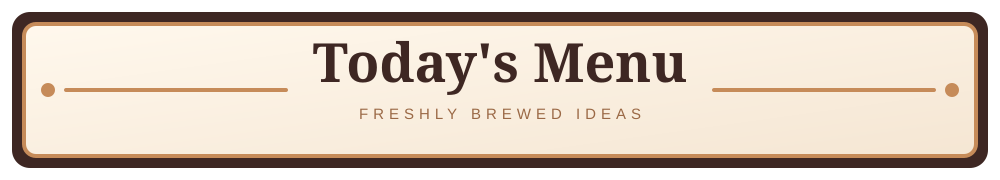

<h1 align="center">☕ Welcome to kilzul's Cafe</h1>

  

---

## 🥐 Our Story

Hi, I'm Raheil Bryce! I'm a student at the University of Ottawa who loves building things with JavaScript.
Right now I'm working on **uoDate**, a dating app UI prototype, and learning **Node.js**.
Ask me about video games, especially Pokémon and Super Smash Bros.

---

  

  
  

  

---

  

<a href="https://github.com/kilzul/sleep-journal">☕ Order Snoozely (view on GitHub)</a>

---

## 🫘 Ingredients

  

---

## 🎶 On the Speakers

  

<b>Now spinning:</b> SONG_ONE · SONG_TWO · SONG_THREE

---

## 💌 Place an Order

📧 [rahsb8@gmail.com](mailto:rahsb8@gmail.com) · 🎮 Discord: `kilzul_qoka`

<i>Tip jar: a ⭐ on my repos is always appreciated.</i>

